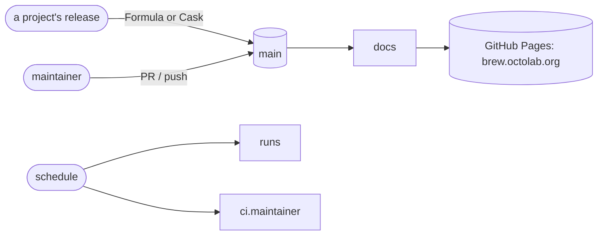
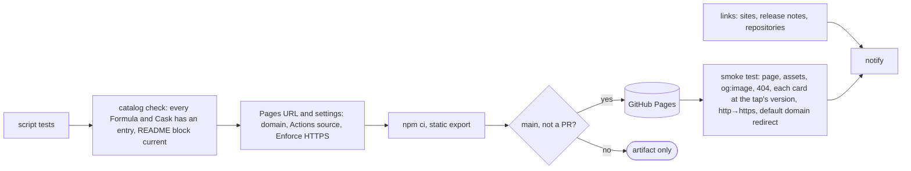

# GitHub Actions

| Workflow | Name | Runs on | Does |
| --- | --- | --- | --- |
| [docs](#docs) | Documentation delivery | PR and push to main (`Formula/`, `Casks/`, `docs/`, scripts, settings), manual | Check the catalog, build the site, deploy it to Pages from main, smoke-test it, check the links |
| ci.\<formula\> | Continuous integration (\<formula\>) | push to main (the Formula), weekly, manual | Install the Formula on macOS and compare its version with the latest release |
| [runs](#runs) | Workflow runs cleanup | monthly, manual | Delete completed runs, with a dry run |

Schedules are in UTC. docs has none on purpose: GitHub disables a scheduled
workflow after 60 days without activity in the repository, and a disabled
workflow ignores pushes as well. Every workflow ends with a `notify` job that posts to
Slack; `SLACK_WEBHOOK` is optional, and an empty value skips the
notification. All external actions use concrete release tags, the ones of
octomation/pulse. Every workflow declares its permissions, and the
repository's default token is read-only. Dependabot checks the `github-actions` ecosystem and the npm
packages of `docs/` daily.

The checks of godownloader, goimports, golangci-lint and sparkle are off:
those Formulae stay at their last release. `.github/settings.json` records
that, so `node .github/scripts/site.mjs doctor` does not report them.



## docs

[cd.docs.yml](cd.docs.yml) builds the Nextra site in `docs/` and deploys it to
GitHub Pages.



- A release of a product pushes its Formula or Cask to main with the token of
  the GitHub App "OctoLab Releaser". Pushes with an App token start workflows,
  so the site follows the tap without anyone touching it.
- A Formula or Cask without an entry in `docs/catalog.json` stops the build:
  the previous deployment stays online until the entry is added
  ([AGENTS.md](../../AGENTS.md#add-a-package)).
- The build needs the full history (`fetch-depth: 0`) for the date of each
  package.
- `Check the Pages settings` reads the Pages configuration with the workflow
  token (`pages: read`) and fails when the source, the domain or Enforce HTTPS
  differ from `.github/settings.json`. After the deployment, the smoke test
  checks the same from outside: `http://brew.octolab.org/` must answer with a
  permanent redirect to `https://brew.octolab.org/`.
- The links job fails on a site, release note or repository of the catalog
  that does not answer twice, 5 seconds apart; it asks four at a time. It never blocks the deployment; its failure reaches
  the notification.
- PRs build a preview artifact and get no notification.
- Between releases nothing runs: a project site that goes down or a Pages
  setting that changes is found by the next push, or by hand with
  `node .github/scripts/site.mjs doctor` and `node .github/scripts/catalog.mjs links`.

### Set up GitHub

Nothing here is stored in the repository, so a fresh repository or a fork
needs it once:

1. Settings → Pages → Source: **GitHub Actions**; the `github-pages`
   environment must allow deployments from main. Custom domain:
   `brew.octolab.org`, declared as `pages.cname` in `.github/settings.json`,
   with Enforce HTTPS on once the certificate is issued.
2. Enable the workflows that GitHub disabled for inactivity, after pushing
   the YAML that should run: `ci.maintainer.yml` and `cleanup.runs.yml`, with
   `gh workflow enable <file> -R octolab/homebrew-tap`. Both have a schedule,
   so a quiet tap disables them again after 60 days; the doctor reports it.
   Settings → Actions → Workflow permissions: read repository contents only.
3. Dispatch docs (`gh workflow run cd.docs.yml -f reason="first deployment"`),
   then run `node .github/scripts/site.mjs doctor`.

## runs

[cleanup.runs.yml](cleanup.runs.yml) deletes completed workflow runs, without
age or count retention. Scheduled runs target all workflows; a manual run
targets the one selected, `Workflow runs cleanup` by default. Try `dry_run`
first: it deletes nothing.

## Local checks

```sh
node --test .github/scripts/*.test.mjs
node .github/scripts/catalog.mjs check
node .github/scripts/catalog.mjs links
actionlint
```
